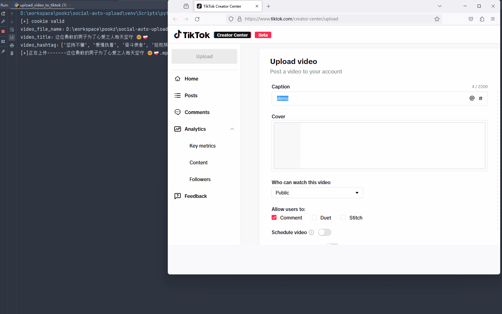

# GEO 智能内容分发平台

这是一个基于 **OmniPost** uploader 能力构建的 GEO 内容生产与自动分发平台：品牌资料进入系统后，可完成 AI 内容生成、规则型 GEO Score、AI 优化、多平台即时/定时发布和结果追踪。原项目的视频、图文 uploader、桌面内嵌账号管理和统一 CLI（`sau`）继续保留。

当前二开版本在保留原 uploader 与 CLI 的基础上，增加了品牌项目、AI 内容生成、GEO Score、内容库、统一发布任务、Demo Mode 和定时发布链路。新业务模块与原 uploader 解耦，真实平台仍需人工登录并遵守平台验证流程。

> 本仓库基于 [rehatRobot/omnipost](https://github.com/rehatRobot/omnipost) 二开；该项目源自 [dreammis/social-auto-upload](https://github.com/dreammis/social-auto-upload)。感谢原作者与社区贡献者。



## 赞助商

<table width="100%">
  <tr>
    <td width="25%" align="center" valign="middle">
      <a href="https://api.rehat.cn/">
        <strong>Rehat API</strong>
      </a>
    </td>
    <td width="75%" align="left" valign="middle">
      <a href="https://api.rehat.cn/">Rehat API</a>：稳定好用的 AI 大模型中转站。一套接口打通 Claude、GPT、Gemini、DeepSeek、通义等主流模型，兼容 OpenAI 协议，OpenClaw、Claude Code、Codex、Cherry Studio 等工具可直接接入。按量计费、延迟低、适合日常开发与自媒体 Agent 场景。
      <a href="https://api.rehat.cn/">https://api.rehat.cn/</a>
    </td>
  </tr>
</table>

---

## 目录

- [赞助商](#赞助商)
- [功能特性](#功能特性)
- [版本演进与更新记录](#版本演进与更新记录)
- [架构概览](#架构概览)
- [环境要求](#环境要求)
- [安装](#安装)
- [桌面交付与历史-Web-边界](#桌面交付与历史-web-边界)
- [快速开始](#快速开始)
- [平台能力](#平台能力)
- [配置说明](#配置说明)
- [文档索引](#文档索引)
- [AI Agent](#ai-agent)
- [免责声明](#免责声明)
- [贡献](#贡献)
- [致谢](#致谢)
- [许可证](#许可证)

## 功能特性

- **多平台发布**：抖音、B 站、小红书、快手、视频号、百家号、今日头条、搜狐号、知乎、TikTok，以及失败关闭的微博官方连接器
- **视频 + 图文**：部分平台支持图文 / 文章（见能力表）
- **账号与 Cookie 管理**：桌面端扫码 / 导入 Cookie，CLI `login` / `check`
- **定时发布**：多数平台支持（以各平台后台能力为准）
- **统一 CLI**：`sau <platform> <action>`，便于脚本化与 Agent 调用
- **可扩展 uploader**：每个平台独立模块，便于二开接入新平台
- **GEO 内容工作流**：品牌底稿 → AI 生成 → GEO 评分/优化 → 内容库 → 多渠道分发
- **内容生产提效**：内置/自定义内容模板、最多 20 个主题批量生成、Excel/CSV 批量导入
- **图片工作流**：从素材库智能推荐封面，或自动生成 1200×628 中性 GEO 封面并关联稿件
- **统一桌面分发**：10 个渠道共用同一发布清单；图文渠道校验图片，视频渠道校验视频
- **可追踪发布任务**：`queued / processing / success / failed / need_action / scheduled`
- **安全 Demo Mode**：完整执行任务状态链，但明确标记为演示且不访问真实平台

为什么还需要这种项目：上传是高频、重复、流程固定的工作。与其每次让通用 Browser Agent 临场解析页面，不如把已验证的发布链路固化成脚本、CLI 和桌面任务。

## 版本演进与更新记录

> 版本口径：仓库目前没有 Git Tag，以下版本号依据 `pyproject.toml`、`sau_frontend/package.json` 与对应提交历史整理。文中的“已接入”表示代码、适配器和安全门禁已经实现，不代表平台一定审核通过，也不承诺账号不会触发验证码、人工审核或风控。真实平台验收边界以 [GEO MVP 验收记录](./docs/GEO-MVP-ACCEPTANCE.md) 为准。

### `0.1.0`：上传器基础与第一版 GEO MVP（2026-08-05 至 2026-09-08）

- 以 OmniPost 多平台 uploader 为基础，提供 Web 管理台、统一 `sau` CLI、示例脚本、账号/Cookie、素材和定时发布能力。
- 2026-09-01 完成第一版 GEO MVP：品牌项目、AI 内容生成、规则型 GEO Score、内容库、Dashboard、统一发布任务和 Demo Mode。
- 接入知乎、今日头条、搜狐号、百家号和小红书的受控文章/图文流程；只有取得公开链接或平台后台证据时才允许确认成功。
- 增加任务图片持久化、定时授权指纹、失败状态对账以及防重复提交保护。
- 增加内容模板、批量主题、Excel/CSV 导入、素材推荐、封面生成和 10 渠道统一分发基础，详情见 [P2 内容与分发记录](./docs/p2-web-integration.md)。
- 增加自定义 OpenAI-compatible AI 服务、安全 Demo 部署、运营访问门、限流、独立 Worker 和隔离生产服务栈。

这一阶段 Python 包版本为 `0.1.0`，前端仍为 `0.0.0`，还不是统一版本号的 Windows 桌面发行版。初始提交为 `3530233`，GEO MVP 代表提交为 `bded6e5`。

### `1.0.0`：Windows 桌面 Beta（2026-09-09，`c57a0d7`）

- 首次交付 Windows GEO 桌面 Beta，将 Vue、Flask、SQLite 和本地服务打进单文件 EXE。
- 桌面宿主使用随机 `127.0.0.1` 端口和 Edge WebView2，不要求把业务后端暴露到公网。
- 增加本机管理员访问门、运行数据目录、数据库备份和桌面进程生命周期管理。
- 增加 AI 可见度分析、历史记录和可追溯的本地量化结果；模型 API 采样与真实消费端 App/网页结果明确区分。
- 增加安全版/授权真实发布版构建配置、版本资源、健康检查和打包后产品冒烟测试。

### `1.1.0`：桌面产品化与真实采样基础（2026-09-10，`b0379db`）

- 将桌面 Beta 产品化，补齐启动状态、运行环境检查、备份和异常恢复提示。
- 增加商业 GEO 诊断、问题分级、DongClaw 评估协议和操作员确认后的受控 AI 可见度采样。
- 建立 AI 调用用量、价格快照和成本台账底层，未知用量不再显示成虚假的零成本。
- 增加批量生成、发布预检、批次执行结果对账和页面状态恢复基础。
- 修复桌面端在常用窗口宽度下的裁切、双滚动条和关键操作按钮不可见问题。

### `1.2.0`：GEO Article Compiler 与可引用性门禁（2026-09-10，`98c8b33`）

- 新增 GEO Article Compiler，在生成前建立用户问题、品牌实体、证据、结论边界和目标平台蓝图。
- 将内容从“关键词文章”升级为可独立抽取的证据单元，强化答案前置、实体归因、来源、日期和适用范围。
- 新增 AI 可引用性规则与发布硬门禁，区分普通质量建议和必须阻止发布的 P0 问题。
- 将同一份编译快照接入内容创作、GEO 优化、评分和发布执行，避免页面间评分口径漂移。

### `1.2.1`：成本账单与发布预检（2026-09-10，`4d74386`）

- 新增独立“成本账单”页面和 API，可按项目、操作、模型与时间查看 AI 调用成本。
- 保存 Token、服务商、模型、价格快照、币种和核算状态；缺少 usage 或价格时明确标记“未知”。
- 强化文章级、平台级发布预检，把内容、素材、账号和确定性规则问题放在真实发布之前处理。
- GEO 诊断、内容优化和发布操作开始共用统一成本与证据回执。

### `1.2.2`：统一 AI 角色与平台单独规则（2026-09-10，`af6adb6`）

- 增加写稿、调优、评估/回测和生图四类 AI 角色的统一配置入口。
- Windows API Key 使用 DPAPI 本机加密保存，状态接口只返回是否已配置，不返回密钥明文。
- 增加内容清洗、平台独立正文/标题/素材规则和发布安全线。
- 增加明确的配置诊断、发布阻塞原因和失败关闭机制；刷新页面后仍可恢复队列与任务状态。

### `1.2.3`：结果驱动的 GEO 黑盒实验与发布结果分类（2026-09-10，`516a275`）

- 新增 GEO 黑盒实验框架，以基线、对照问题簇和发布后复测记录真实变化，不用单一“魔法分数”代替结果。
- 将发布结果拆分为已公开、平台处理/审核中、需要人工处理和明确失败，状态不明不再当成成功。
- 只有公开 URL 或足够的平台后台证据才能完成成功对账；超时不会自动重复提交。
- 强化知乎、今日头条、搜狐号、百家号和小红书的页面流程、结果核验与路由恢复。

### `1.2.4`：账号风险、多模型角色与批量 GEO（2026-09-10，`44dcd55`）

- 新增媒体账号风险诊断、异常提示和账号状态聚合，区分 Cookie 失效、平台验证、审核和封禁风险。
- 完善写稿、调优、评估和生图模型的独立路由与调用回执，避免把回退模型伪装成独立模型。
- 增加内容角度、结构、语气和证据侧重点的可追溯差异化生成，减少固定模板和批量同质化。
- 完善多篇文章、多平台矩阵预检、批量任务创建及受控串行执行。

### `1.2.5`：按长度评分、平台压缩、自愈与多模型监督（2026-09-11 至 2026-09-14，`88626b0` 至 `a555616`）

- 针对 200、600、1000、1500 字建立不同的结构和评分口径，短内容不再因缺少长文 FAQ、多个 H2/H3 等项目被错误扣分。
- 为各平台维护独立的标题、正文、话题、素材和字数安全线；发布副本超限时压缩副本而不覆盖原稿。
- 增加生成会话持久化和页面切换恢复，保留不可变的生成、调优、评分和证据快照。
- 将用户配置的自有证据绑定到生成结果，并在成功和失败回执中记录真实服务商、模型、请求 ID、用量与未知成本边界。
- 增加独立 IMAGE 角色、受控生图、平台页面风险诊断和安全可恢复的发布自愈；仅对提交前的已知安全问题自动修复一次，结果不明时禁止盲目重发。
- AI 可见度采样限制为 1–5 次顺序调用，展示真实模型身份；新增 writer/reviewer/evaluator 多模型面板，但模型 API 结果不会冒充豆包、元宝、千问等消费端实测。
- 增加平台审核状态监测、通过/退回/账号风险提醒、后台管理入口和人工核验跳转，保持“已公开、处理中、待人工、失败”四类结果互斥。
- 增加可复现内部源码包、逐文件 SHA-256、密钥扫描、解压复核和 Windows EXE 的健康/鉴权/WebView2 冒烟证据。
- 增加完整的 [AI 开发与系统详细说明](./docs/GEO_AI开发与系统详细说明.md)。

### `1.2.6`：模型兼容、微博连接器与发布状态修复（2026-09-15 至 2026-09-16）

- Seedream 图片调用改为兼容服务要求的最小 `model + prompt` 请求，并细分模型不存在、权限、限流和错误接口等诊断。
- 增加 IMAGE 角色的图片/视频模型识别，防止把 Seedance 视频模型误填为生图模型。
- 修复 Mihomo/TUN Fake-IP 环境把正常公网图片地址误判成私网的问题；仍阻止 IP 字面量、真实私网、危险映射域名、不安全跳转和超大/非图片响应。
- 修复多模型可见度面板在首条采样失败时显示 `unknown · unknown` 的问题：回执会从冻结配置恢复真实服务商和模型，并明确区分“取得有效回答的模型数”和“已发起的调用目标数”。
- 模型网关请求显式使用非流式 Chat Completions；上游 HTTP 504 保留为“远端结果不明确”并禁止自动重试，协议不兼容时给出可操作诊断，不再把不同故障压成同一条 502。
- 扩展模型响应兼容层，可读取常见网关封装、Responses 风格文本、旧式 `choices[].text` 和完整 SSE 回包；仍不会把 `reasoning_content` 当作正式答案。
- 多模型 API 对照默认每个角色仅采样 1 次；若供应商报告的输出 Token 显著超过请求上限，保留已取得的回答和费用凭据后立即熔断该角色，避免继续超额调用。
- 多模型失败只显示一份结构化面板回执，保留请求身份、恢复策略和账单核对边界；项目切换时清除旧项目回执，避免跨项目误读。
- 修复 frozen Windows 桌面窗口关闭后 WebView2/CLR 线程残留导致旧 EXE 僵留的问题；完整释放调度器、HTTP 服务和单实例锁后强制结束打包子进程。
- 微博官方 OAuth/连接器、账号绑定、文本/单图预检、AI 生成声明与公开作品核验已完成代码和自动化测试；当前机器尚未完成官方 CLI 运行时、OAuth 和真实账号验收，缺少这些条件时保持失败关闭，不能宣传为已经完成真实发布验收。
- 搜狐号增加标题/正文指纹、历史退回快照和账号冷却期门禁；明确退回的原稿不能仅靠更换文章 ID 或账号绕过，必须完成实质修改后重新预检。
- 修复发布审核监测的账号绑定漂移：旧任务不会使用新账号继续核验；人工确认成功会关闭耗尽告警，人工失败只暂停核验，不伪造为平台退回。

本轮源码版本统一提升为 `1.2.6`，尚未创建 Git Tag。源码已通过 1189 项后端测试（跳过 1 项）、164 项前端测试和 Vue 生产构建；正式交付仍必须以清洁提交重新运行打包门禁，并核对成品健康检查、WebView2 冒烟、提交号、`source_dirty`、构建时间和 SHA-256。

### `1.2.7`：可见度采样协议与诚实量化门禁（2026-09-16）

- 修复豆包、DeepSeek、GLM 等推理模型在多模型可见度采样中只返回推理过程、最终答案为空的问题；采样请求按已知模型协议关闭思考输出，文章生成和调优仍保留原来的质量策略。
- 扩展 OpenAI-compatible 回包兼容层，支持递归网关封装、文本分片、显式最终答案、Responses 输出和完整 SSE；任何 `reasoning_content`、`thinking` 或 `analysis` 都不会被误算成回答。
- 采样前执行零网络、零计费的本地契约预检；单个角色输出限制为 768 Token、超时上限为 120 秒，空回包、协议错误和无法受控的输出会立即停止该角色后续采样。
- 每次调用前持久化检查点，明确区分请求是否可能已发出、供应商结果和计费结果；超时或结果未知时同一幂等键只回放旧回执，不会自动重试或重复计费。
- 新增 GEO 量化硬门槛：0 条有效回答为“不可量化”；至少 2 个独立完整模型才可做方向性比较；至少 5 条有效回答且对照合格才可量化 API 渠道。
- 页面新增样本有效率、证据置信度、量化阻塞原因和总体 GEO 分隐藏逻辑；供应商 API 结果明确不等于豆包、千问、DeepSeek 等消费者 App / Web 的真实回答、联网检索或引用收录。
- 项目准备度分与总体 GEO 可用分拆开显示，避免把配置完整度、内容规则分或 API 样本误卖成真实消费端可见度。

`1.2.7` 源码已通过 1201 项后端测试（跳过 1 项）、166 项前端测试和 Vue 生产构建；最终构建提交、产物路径、哈希和成品冒烟结果仍以对应发行 manifest 为准。未取得真实供应商回答和消费者入口证据前，不对外宣称已经完成 GEO 效果验证。

## 架构概览

| 部分 | 说明 |
| --- | --- |
| `sau_backend.py` | 桌面内置的回环 Flask API：账号、素材、发布任务 |
| `sau_frontend/` | EXE 内嵌的 Vue3 + Element Plus 管理台（账号 / 素材 / 发布中心） |
| `services/` | GEO 评分、AI、项目/文章、发布适配器、执行器与调度服务 |
| `uploader/*` | 各平台 Playwright / 专用运行时上传实现 |
| `sau_cli.py` | 统一 CLI 入口（安装后命令为 `sau`） |
| `examples/` | 单平台登录 / 上传示例脚本 |
| `skills/` | 面向 Agent 的平台 Skill（抖音 / 快手 / 小红书 / B 站） |
| `db/` | SQLite 账号与文件元数据 |

## 环境要求

- Python **3.10+**（推荐 3.11）
- Node.js **18+**（开发界面或构建内嵌 Vue 的桌面 EXE 时需要）
- Windows（桌面 EXE）；macOS / Linux 仅保留 Python CLI 与源码开发能力
- 推荐使用 [`uv`](https://github.com/astral-sh/uv) 管理依赖

## 安装

详细步骤见：[安装说明](./docs/install.md) · [更新说明](./docs/update.md)

### 1. 克隆与 Python 依赖

```bash
git clone https://github.com/rainy321/geo-content-distribution-platform.git
cd geo-content-distribution-platform

uv venv
# Windows
.venv\Scripts\activate
# Linux / macOS
# source .venv/bin/activate

uv pip install -e .

# 开发桌面内嵌界面或历史 Web 兼容层时安装 web 可选依赖
uv pip install -e ".[web]"
```

安装后可直接使用 `sau` 命令；为兼容原 uploader 与脚本生态，CLI 入口名保持不变。

### 2. 浏览器驱动

主线使用 `patchright`（兼容 Playwright API）：

```powershell
# Windows 国内镜像示例
$env:PLAYWRIGHT_DOWNLOAD_HOST="https://npmmirror.com/mirrors/playwright"
patchright install chromium
```

部分平台 / 示例仍可能使用 `playwright`，可按需补充：

```bash
playwright install chromium
```

### 3. 配置与数据库

```bash
python db/createTable.py
```

`conf.py` 只包含可公开的默认值；本地 Chrome 路径、无头模式等通过 `LOCAL_CHROME_PATH`、`LOCAL_CHROME_HEADLESS`、`DEBUG_MODE` 环境变量覆盖。**不要**把 `.env`、`cookies/`、`cookiesFile/`、`database.db` 提交到公开仓库。

### 4. Web 前后端（可选）

```bash
# 后端
python sau_backend.py
# 默认 http://localhost:5409

# 前端
cd sau_frontend
npm ci
npm run dev
# 默认 http://localhost:5173
```

Windows 在完成依赖安装后也可双击 `start-win.bat`。脚本会从仓库目录启动并优先使用 `.venv`，只在未显式配置时启用 Demo 数据、关闭真实发布，前后端均只对本机开放。

本地演示建议显式开启 Demo Mode：

```powershell
# PowerShell
$env:DEMO_MODE="true"
python sau_backend.py
```

```bash
# Linux / macOS
DEMO_MODE=true python sau_backend.py
```

Demo Mode 首次连接到**完全空的数据库**时，会在一个事务内准备“XX科技（示例数据）”、6 篇带“示例数据”标签的文章，以及覆盖成功、失败、等待确认和计划中状态的演示发布历史。重复启动不会重复写入；只要数据库里已有任意项目、文章或发布任务，种子服务就会跳过，不会把样例混进用户数据。可通过 `SEED_DEMO_DATA=false` 单独关闭这一行为。

## 桌面交付与历史 Web 边界

当前产品只交付 Windows 桌面 EXE，不再把旧 Vercel 演示站或独立网页部署作为产品入口。桌面程序在随机的 `127.0.0.1` 端口运行内置 Flask API，并通过 Edge WebView2 显示打包后的 `sau_frontend/`，因此前端目录仍是桌面软件源码的一部分。

仓库暂时保留 `sau_web.py`、Docker/Compose、Vercel 和服务器部署样例，用于历史兼容、测试和后续代码迁移；这些文件不表示网站仍在维护，也不是运行 EXE 的前置条件。详细边界见 [历史 Web 说明](./docs/legacy-web.md) 与 [Windows 桌面版交付说明](./docs/windows-desktop.md)。

## 快速开始

### 方式 A：桌面发布中心

1. 启动 Windows EXE；源码开发时才分别启动后端与前端
2. 在「品牌项目」维护品牌事实和核心关键词
3. 使用「AI 内容创作」生成稿件，在「内容库」标记为就绪
4. 在「发布中心」选择稿件与多个平台，创建即时或定时任务
5. Demo Mode 会自动完成演示任务；真实发布需要先在「媒体账号」完成人工登录

适合日常运营与多账号可视化管理。

### 桌面内置 API

以下接口由 EXE 内部的本机 Flask 服务提供；它们是桌面界面与业务层之间的契约，不代表需要部署公网网站。

| 方法 | 路径 | 说明 |
| --- | --- | --- |
| `POST` | `/api/articles/generate` | 通过 OpenAI-compatible API 生成 GEO 稿件 |
| `POST` | `/api/articles/generate-batch` | 最多按 20 个主题生成并保存独立草稿 |
| `GET/POST` | `/api/content-templates` | 查询或创建内容模板 |
| `PUT/DELETE` | `/api/content-templates/:id` | 更新或删除自定义内容模板 |
| `GET` | `/api/articles/import-template.xlsx` | 下载标准文章导入模板 |
| `POST` | `/api/articles/import` | 从 Excel/CSV 批量导入文章 |
| `GET/POST` | `/api/articles/:id/images/recommend`、`/images/generate` | 推荐素材或生成文章封面 |
| `GET/POST` | `/api/auth/status`、`/api/auth/login` | 查询访问门状态、建立 HttpOnly 运营会话 |
| `POST` | `/api/auth/logout` | 退出当前运营会话 |
| `POST` | `/api/geo/score` | 计算规则型 GEO Score |
| `POST/GET` | `/api/projects` | 创建或查询品牌项目 |
| `POST/GET` | `/api/articles` | 保存或查询文章 |
| `POST` | `/api/publish` | 为一个文章和平台创建发布任务 |
| `GET` | `/api/publish/jobs` | 查询发布任务与历史 |
| `GET` | `/api/publish/jobs/:id` | 轮询单个任务状态 |
| `POST` | `/api/publish/jobs/:id/retry` | 将失败/待人工任务重新排队 |
| `POST` | `/api/publish/jobs/:id/execute` | 仅执行明确标记的 Demo 任务 |
| `POST` | `/api/publish/jobs/:id/execute-real` | 三重门控后执行已确认的 11 渠道真实任务 |
| `GET` | `/api/publish/platforms` | 读取统一渠道能力与素材要求 |
| `GET` | `/api/media-accounts` | 读取媒体账号与平台连接概览，不主动检测平台 |
| `POST` | `/api/media-accounts/:id/check` | 用户显式触发单账号 Cookie 状态检测 |

多平台分发会为每个平台创建一条独立任务。一个平台失败不会阻塞其他平台，验证码、扫码、Cookie 失效、风控和页面结构变化统一进入 `need_action`，不会尝试绕过平台验证。

### 方式 B：CLI（当前已接入平台）

```bash
sau douyin login --account <account_name>
sau douyin check --account <account_name>
sau douyin upload-video --account <account_name> --file videos/demo.mp4 --title "示例标题" --desc "示例简介"
sau douyin upload-note --account <account_name> --images videos/1.png videos/2.png --title "图文标题" --note "图文正文"

sau kuaishou login --account <account_name>
sau kuaishou upload-video --account <account_name> --file videos/demo.mp4 --title "示例标题"

sau xiaohongshu login --account <account_name>
sau xiaohongshu upload-note --account <account_name> --images videos/1.png videos/2.png --title "图文标题" --note "正文"

sau bilibili login --account <account_name>
sau bilibili upload-video --account <account_name> --file videos/demo.mp4 --title "示例标题" --tid 249
```

更多说明：[CLI 使用说明](./docs/CLI.md)

约定简述：

- `account_name` 是你自定义的账号名，对应 `cookies/<platform>_uploader/<account_name>.json`
- 视频元数据常用：`title + desc + tags`
- 图文元数据常用：`title + note + tags`
- B 站首次相关命令会自动准备 `biliup`；登录建议在本地真实终端执行

### 方式 C：examples 脚本

适合调试单平台 uploader（头条 / 搜狐 / 知乎 / 百家号图文等尚未全部 CLI 化时，优先用此方式或 Web）：

```bash
# 登录示例
python examples/get_toutiao_cookie.py
python examples/get_sohu_cookie.py
python examples/get_zhihu_cookie.py

# 发布示例（按脚本内注释修改路径与文案）
python examples/upload_article_to_toutiao.py
python examples/upload_article_to_sohu.py
python examples/upload_article_to_zhihu.py
python examples/upload_article_to_baijiahao.py
```

抖音 / 快手 / 小红书 / B 站优先用 `sau ...`，不必再走旧示例主路径。

### 桌面统一内容链路

Windows 桌面版已把模板、批量文章、Excel/CSV 导入、自动配图和 11 个渠道接进同一条内容分发链路：

1. 在「AI 内容创作」选择内置或自定义模板，也可一次生成最多 20 个主题草稿。
2. 在「内容库」下载标准 Excel 模板并批量导入文章。
3. 在「发布中心」选择稿件与渠道；百家号、小红书、抖音、快手需要图片，Bilibili、视频号、TikTok 需要视频。
4. 图片可从素材库智能推荐，也可让系统生成中性 GEO 封面；视频从素材库上传选择。
5. 每个渠道创建独立、可追踪的发布任务，真实执行仍受 `ALLOW_REAL_PUBLISHING` 和逐次确认保护。

这部分能力的历史接入记录见 [`docs/p2-web-integration.md`](./docs/p2-web-integration.md)；当前交付边界以桌面版文档为准。

## 平台能力

| 平台 | 登录 | 视频 | 图文/文章 | 定时 | CLI | Skill | 备注 |
| --- | --- | --- | --- | --- | --- | --- | --- |
| 抖音 | ✅ | ✅ | ✅ | ✅ | ✅ | ✅ | CLI/Skill 最完整 |
| Bilibili | ✅ | ✅ | ❌ | ✅ | ✅ | ✅ | 依赖 `biliup` 运行时 |
| 小红书 | ✅ | ✅ | ✅ | ✅ | ✅ | ✅ | 浏览器自动化 |
| 快手 | ✅ | ✅ | ✅ | ✅ | ✅ | ✅ | 浏览器自动化 |
| 视频号 | ✅ | ✅ | ❌ | ✅ | ❌ | ❌ | `tencent_uploader` |
| 百家号 | ✅ | ✅ | ✅ | ✅ | ❌ | ❌ | 桌面端 / examples |
| 今日头条 | ✅ | ✅ | ✅ | ✅ | ❌ | ❌ | 图文为「发文章」，非微头条 |
| 搜狐号 | ✅ | ❌ | ✅ | ✅ | ❌ | ❌ | 仅图文；标题 5–72 字；封面 **大于 450×300**，jpg/jpeg/png，≤10MB |
| 知乎 | ✅ | ❌ | ✅ | ✅ | ❌ | ❌ | 第一期仅文章 |
| TikTok | ✅ | ✅ | ❌ | ✅ | ❌ | ❌ | 示例偏 Chrome 版实现 |
| 微博 | ✅ | ❌ | ✅ | ❌ | ✅ | ❌ | 官方 CLI/OAuth 桥；文本/单图；未安装、未授权或缺少真实账号验收时失败关闭 |

平台后台改版、风控、账号权限（如实名）会导致自动化失效，属正常现象，需要跟进维护选择器与流程。

## 配置说明

- 运行配置：[`conf.py`](./conf.py) 提供安全默认值，使用环境变量覆盖本地差异
- Cookie 目录：`cookies/`（CLI / 示例）与 `cookiesFile/`（桌面账号）
- 素材目录：常见为 `videoFile/`（以后端实际配置为准）
- 日志：`logs/`

桌面内置服务运行环境变量：

可从 [`.env.example`](./.env.example) 查看无敏感值模板；当前应用不会自动读取 `.env`，请在启动进程或部署平台中显式设置变量。

| 变量 | 默认值 | 用途 |
| --- | --- | --- |
| `AI_BASE_URL` | 无 | OpenAI-compatible API 地址 |
| `AI_API_KEY` | 无 | 模型 API Key，禁止写入仓库 |
| `AI_MODEL` | 无 | 内容生成与优化使用的模型 |
| `APP_ACCESS_PASSWORD` | 空 | 运营访问口令；与 `APP_SESSION_SECRET` 同时配置时启用访问门 |
| `APP_SESSION_SECRET` | 空 | Flask 会话签名密钥；必须是独立随机 Secret |
| `APP_SESSION_HOURS` | `12` | 运营会话有效小时数，范围 1–168 |
| `AUTH_LOGIN_ATTEMPTS_PER_MINUTE` | `5` | 单客户端每分钟口令尝试上限 |
| `AI_RATE_LIMIT_PER_MINUTE` | `0` | 单客户端每分钟 AI 请求上限；0 表示应用内限流关闭，生产建议显式配置 |
| `UPSTASH_REDIS_REST_URL` | 空 | 可选的 Upstash Redis REST 地址；与 Token 同时配置后启用跨实例限流 |
| `UPSTASH_REDIS_REST_TOKEN` | 空 | 可选的 Upstash 标准 REST Token，只允许放在服务端 Secret 中 |
| `CORS_ALLOWED_ORIGINS` | 本地 5173 两个回环地址 | 分离部署时允许携带会话凭据的前端来源，逗号分隔 |
| `SESSION_COOKIE_SECURE` | Vercel 自动开启 | 是否只通过 HTTPS 发送运营会话 Cookie |
| `LOCAL_CHROME_PATH` | 空 | 可选的本机 Chrome 可执行文件路径 |
| `LOCAL_CHROME_HEADLESS` | `true` | uploader 默认是否使用无头浏览器；人工登录时会按登录流程打开可见窗口 |
| `DEBUG_MODE` | `false` | uploader 调试日志开关 |
| `XHS_SERVER` | `http://127.0.0.1:11901` | 仅供小红书旧流程兼容使用 |
| `DEMO_MODE` | `false` | 为 `true` 时新发布任务使用 DemoPublisher |
| `SEED_DEMO_DATA` | `true` | Demo Mode 下为空数据库准备幂等、明确标注的演示数据 |
| `ALLOW_REAL_PUBLISHING` | `false` | 真实发布总开关；统一适配层已覆盖 10 个渠道 |
| `SCHEDULED_REAL_PUBLISHING_ENABLED` | `false` | 定时真实执行专项门；本桌面版本固定关闭，到期真实任务只排队 |
| `GEO_REAL_PUBLISHING_AUTHORIZED` | `false` | 不可变构建是否授权真实发布；不能只靠总开关替代 |
| `GEO_PUBLISHING_RUNTIME_READY` | `false` | Chrome 与打包驱动离线探针是否通过；启动时计算 |
| `DATABASE_PATH` | `db/database.db` | 可覆盖 SQLite 路径，便于隔离环境 |
| `COOKIES_DIRECTORY` | `cookiesFile` | 桌面登录、账号检测和真实发布共用的 Cookie 目录 |
| `MEDIA_ROOT` | `videoFile` | 上传图片/视频、生成封面和发布素材的运行目录 |
| `PUBLISH_SCHEDULER_INTERVAL_SECONDS` | `15` | 到期任务检查间隔，最少 5 秒 |
| `RUN_PUBLISH_SCHEDULER` | `true` | 内置服务进程是否启动调度器；使用独立 `sau-worker` 时设为 `false` |
| `SERVER_HOST` | `127.0.0.1` | 后端监听地址；容器内需显式设为 `0.0.0.0` |
| `SERVER_PORT` | `5409` | 后端监听端口；非法值会回退到 5409 |

桌面管理台的“系统设置”支持统一配置写稿、调优、回测和生图模型。Windows 下 API Key 经 DPAPI 加密后只供当前系统用户使用，状态接口只返回“已配置”，不会返回密钥；未单独配置的角色按界面说明回退到写稿模型。服务地址必须使用公开 HTTPS URL，后端拒绝本机、私网、保留地址和 URL 内嵌凭据。

定时任务由 APScheduler 在 `python sau_backend.py` 启动时注册。每次 tick 会原子地将到期任务从 `scheduled` 提升为 `queued`；Demo 任务随后自动执行。当前版本对真实任务固定关闭后台执行：到点只排队，用户必须打开具体任务，核对同源正文快照、平台、账号、素材和任务版本后再从手动入口执行。历史数据库中的 `auto_execute=1` 任务会在访问平台前转为 `need_action`。桌面宿主、独立后端和 `sau-worker` 都执行同一 fail-closed 边界；失败或状态不明不会自动重试。

10 个渠道的真实发布默认关闭。只有同时满足 `DEMO_MODE=false`、不可变构建授权、`ALLOW_REAL_PUBLISHING=true`、本机运行时探针通过、任务本身不是 Demo，并且操作者在发布中心对当前任务逐次确认时才会进入真实适配器。所有适配器都会先验证登录状态。知乎发布前通过当前账号的公开文章列表精确匹配标题，已存在时直接返回原链接；发布后最多轮询 3 次公开文章结果并自动对账，不会自动重复点击“发布”。其余渠道只有取得平台公开内容链接才标记 `success`；发布器明确完成提交但暂时没有公开链接时保持 `processing`，发布器超时或最终状态未知时转为 `need_action`，两种情况都要求先到平台后台核对，避免盲目重试造成重复内容。百家号、小红书、抖音和快手要求图片，可由操作者选择素材，也可启用受控自动配图；Bilibili、视频号和 TikTok 要求视频。扫码、验证码、实名、风控或 Cookie 失效会进入“待人工确认”，系统不会绕过平台安全机制。五个 P2 渠道的代码适配已完成，真实账号验收状态以 [`docs/p2-web-integration.md`](./docs/p2-web-integration.md) 为准。

> 桌面安全边界：内置 API 默认只绑定随机 `127.0.0.1` 端口，媒体 Cookie、SQLite 数据库和 DPAPI 模型配置都属于当前 Windows 用户的本机运行状态，不进入源码包。不要把本地后端、`cookiesFile/` 或用户数据目录直接暴露到公网。

开发回归：

```bash
uv run python -m unittest discover -s tests -v
cd sau_frontend && npm run build
```

生成内部源码交接包请使用 [`scripts/package_source.ps1`](./scripts/package_source.ps1)，不要直接压缩工作目录；范围与验收步骤见 [源码交付说明](./docs/source-package.md)。

## 文档索引

| 文档 | 内容 |
| --- | --- |
| [docs/GEO_AI开发与系统详细说明.md](./docs/GEO_AI开发与系统详细说明.md) | AI 架构、模型角色、GEO 算法、可见度、发布状态机、安全边界与扩展开发总说明 |
| [docs/install.md](./docs/install.md) | 安装与环境 |
| [docs/update.md](./docs/update.md) | 更新说明 |
| [docs/CLI.md](./docs/CLI.md) | `sau` CLI |
| [docs/agent-bootstrap.md](./docs/agent-bootstrap.md) | 交给 AI Agent 的启动提示词 |
| [docs/source-package.md](./docs/source-package.md) | 干净源码包的范围、生成、验收与重建说明 |
| [docs/legacy-web.md](./docs/legacy-web.md) | 历史 Web 说明 |
| [skills/*/SKILL.md](./skills) | 各平台 Agent Skill |

## AI Agent

如果你把本仓库交给 OpenClaw、Codex、Claude Code 等使用：

1. 先发送仓库 + [Agent Bootstrap Prompt](./docs/agent-bootstrap.md)  
2. 优先让 Agent 走 `uv` + `sau` + `skills/`  
3. 先验证：`douyin` / `kuaishou` / `xiaohongshu` / `bilibili` 四个 CLI 入口  

相关 Skill：

- [Douyin](./skills/douyin-upload/SKILL.md)
- [Kuaishou](./skills/kuaishou-upload/SKILL.md)
- [Xiaohongshu](./skills/xiaohongshu-upload/SKILL.md)
- [Bilibili](./skills/bilibili-upload/SKILL.md)

## 免责声明

- 本项目仅供学习、研究与个人效率提升使用。  
- 使用自动化发布可能违反部分平台用户协议，存在账号限制、验证码、功能不可用等风险，**后果由使用者自行承担**。  
- 请勿用于垃圾信息、违规内容分发或其他违法用途。  
- 平台页面与接口随时变更，不保证某一功能长期可用。

## 贡献

欢迎 Issue / PR：

1. Fork 本仓库  
2. 新建分支：`feature/xxx` 或 `fix/xxx`  
3. 提交清晰的变更说明  
4. 发起 Pull Request  

建议：改动平台自动化时附上复现步骤、日志片段（`logs/`）与是否 dry-run。

## 致谢

- 原项目：[dreammis/social-auto-upload](https://github.com/dreammis/social-auto-upload)
- B 站上传能力基于 [biliup](https://github.com/biliup/biliup) 的接入与封装
- 所有提交 Issue、PR 与反馈的贡献者
- 感谢 [LINUX DO](https://linux.do/) 社区提供的交流氛围与开源推广支持

## 许可证

仓库中由相应版权方合法授权的代码采用 [MIT License](./LICENSE)。MIT 文本不构成对来源不明或尚未完成权利确认材料的权属证明。

使用或二次发布时，请保留许可证与版权声明，并保留对上游项目与 `biliup` 的致谢信息。当前同事算法移植层的交接包未附独立许可证，外部商业分发前还需完成书面权利确认；详见 [GEO 算法融合说明](./docs/GEO算法融合说明.md) 与 [源码交付说明](./docs/source-package.md)。
