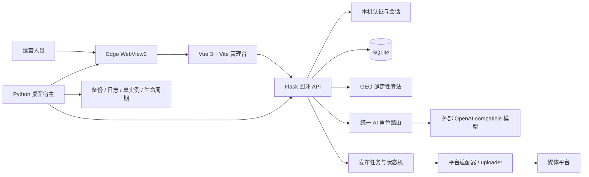
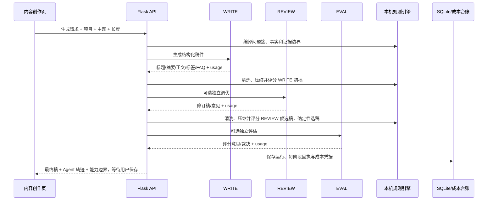
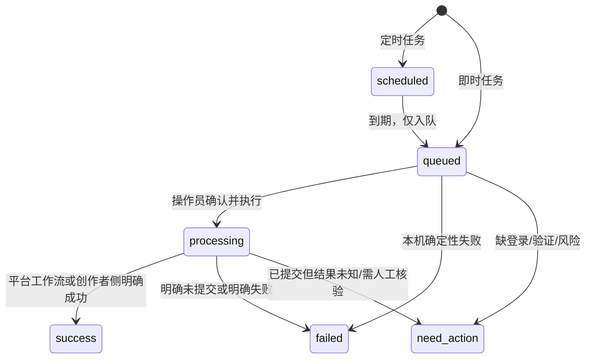

# GEO 智能内容分发平台：AI 开发与系统详细说明

> - 文档状态：当前实现说明
> - 适用产品：GEO 智能内容分发平台 Windows 桌面版
> - 产品版本：`1.2.5`
> - 基线提交：`88e7f4375afea27e067cedf6b8c1d23768cb04f2`
> - 更新时间：2026-09-14
> - 面向读者：产品开发、算法开发、测试、交付、运营和后续接手的 AI Agent

本文把仓库中分散的 AI 配置、文章生成、GEO 编译、可引用性门禁、AI 可见度、黑盒回测、成本台账、平台发布和审核监测说明合并为一份开发总览。本文以当前代码为准；历史 Web、候选服务器架构和上游交接包只在说明来源或扩展方向时出现。

---

## 1. 产品目标与真实性边界

产品解决的不是“猜中某个 AI 平台的秘密权重”，而是建立一条可审计的内容实验闭环：

```text
真实品牌事实
  -> 用户问题簇
  -> GEO 内容蓝图
  -> AI 写稿 / 调优 / 独立评估
  -> 本机可引用性门禁
  -> 各平台独立安全副本
  -> 受控发布与平台审核监测
  -> AI 回答采样或人工导入
  -> 提及 / 位次 / 引用 / SOV / 置信度
  -> 同口径复测与下一轮内容决策
```

必须把以下概念分开：

| 层次 | 当前能回答的问题 | 当前不能保证的结果 |
| --- | --- | --- |
| 内容准备度 | 文章是否包含清晰实体、直接回答、证据、限制和可提取结构 | 搜索引擎一定抓取或建立索引 |
| 平台发布 | 软件是否取得公开链接、平台是否明确受理或需要人工处理 | 平台一定审核通过、账号永不受限 |
| API 模型采样 | 指定 OpenAI-compatible 模型在这次 API 调用中如何回答 | 豆包、元宝、千问、ChatGPT 等 App/网页入口给出相同答案 |
| AI 可见度分析 | 当前样本中品牌是否被提及、排在何处、是否带显式 URL | 整个平台的总体市场份额或长期自然流量 |
| 黑盒回测 | 相同采样协议下，处理组相对对照组发生了什么变化 | 单次测试已经证明因果或平台内部权重 |

因此，对客户可以表述为：系统提高内容的可发现、可理解、可检索和可引用准备度，并用固定样本协议测量结果。不得表述为“达到某分就保证被 AI 收录”“软件保证所有平台审核通过”或“发布后一定不会封号”。

---

## 2. 当前能力状态

### 2.1 已实现

- Windows 本机单用户桌面程序，内嵌 Vue 管理台和回环 Flask API。
- 统一 AI 角色配置：`writer`、`reviewer`、`evaluator`、`image`。
- Qwen、DeepSeek、豆包/火山方舟和自定义 OpenAI-compatible 服务配置。
- Windows DPAPI 保护 API Key；状态接口从不回传明文密钥。
- 单篇和最多 20 个主题的批量文章生成。
- 200–3000 字自定义长度，以及 200/600/1000/1500 常用档位。
- 查询意图矩阵、GEO 内容蓝图、实体事实边界、证据约束和内容多样化。
- 写稿、调优、独立评估三阶段审计回执；同模型不会伪装成独立多模型。
- 独立 IMAGE 角色生图；未配置时使用本机确定性封面。
- 规则型 GEO Score 与独立的 AI 可引用性门禁。
- 按目标长度调整评分适用项，短稿不再被长文 FAQ/H2 要求机械扣分。
- AI 回答手工导入、本机分析、受控 API 采样和多模型 API 对照面板。
- 处理组/对照组、基线/第 7/14/30 天的黑盒实验数据合同。
- 模型调用 Token 与成本台账；未知 Token 和未定价调用不会显示为 0。
- 10 个发布渠道的能力清单、平台独立副本、离线预检、批量任务和受控真实执行。
- 标题/字数/格式类问题的一键本机修复并重检。
- 平台结果人工核验、公开链接校验、低频审核监测和媒体账号风险提示。
- 页面重载后按持久化请求或任务 ID 恢复采样和发布状态，不自动重复调用。

### 2.2 需要外部证据才能成立

- 真实模型 API 是否可用：取决于精确 Base URL、模型或接入点 ID、API Key、额度和供应商状态。
- 消费者 App/网页结果：需要在对应入口用相同问题另行实测或把回答手工导入。
- 媒体平台是否审核通过：取决于账号、内容、动态规则、实名和平台审核。
- 搜索抓取、索引、检索和引用：需要搜索控制台、站点日志、公开 URL 和长期复测证据。
- GEO 效果增长：需要固定问题簇、固定模型/入口、失败分母、对照组和 7/14/30 天复测。

### 2.3 当前未实现或不应实现

- 不自动登录第三方 AI 消费者网页并冒充普通用户采样。
- 不绕过短信、扫码、滑块、实名或平台风控。
- 不在结果未知时自动重试模型调用或再次点击发布。
- 不自动轮换账号规避封禁或限流。
- 不根据少量样本伪造 GEO 增长、索引率、引用率或官方平台分数。
- 不把同一 provider、endpoint 和 model 的多个角色计为独立模型意见。
- 不把手工填写的 provider/model 标签当作来源真实性证明。
- 不把显式 URL 自动当作已联网核验的证据。

---

## 3. 系统架构

### 3.1 运行时架构



Windows 成品不是网站快捷方式。`GEO-Content-Platform.exe` 在随机 `127.0.0.1` 端口启动 Waitress/Flask，再由 WebView2 打开内置前端。默认不对公网监听，也不读取正式服务器数据库。

### 3.2 源码目录职责

| 路径 | 主要职责 |
| --- | --- |
| `sau_backend.py` | 本机认证、AI 配置、文章、GEO、可见度、成本、账号和发布 API |
| `sau_frontend/src/` | Vue 产品界面、页面恢复、用户确认和结果展示 |
| `services/` | AI 调用、内容编译、评分、可见度分析、成本和发布状态机 |
| `uploader/` | Playwright/Patchright 或平台专用发布实现 |
| `db/createTable.py` | SQLite 主表和兼容式初始化 |
| `desktop/` | Windows 宿主、WebView2、数据目录、单实例、备份和进程生命周期 |
| `scripts/` | 源码打包、Windows 构建、验收和辅助工具 |
| `tests/` | 后端、桌面、发布安全、算法和 API 回归 |
| `sau_frontend/tests/` | 前端状态归一化、页面流程和安全边界测试 |

当前产品路由 `/publish-center` 实际加载 `sau_frontend/src/views/DistributionCenter.vue`。仓库仍保留旧版 `PublishCenter.vue` 作为历史代码，后续维护不应误把旧组件当作当前发布中心。`ContentCreation.vue` 和 `AiVisibility.vue` 使用 Vue `KeepAlive`，但付费长任务的真正恢复依据仍是后端持久化 request ID，而不是组件是否还在内存。

### 3.3 核心服务

| 服务文件 | 职责 |
| --- | --- |
| `services/ai_service.py` | OpenAI-compatible Chat Completions 调用、端点归一化、错误分类 |
| `services/unified_ai_config_service.py` | 多角色配置、DPAPI 密钥、角色回退和独立性判定 |
| `services/content_generation_service.py` | 写稿、可选调优、可选评估、审计和失败收口 |
| `services/geo_article_compiler_service.py` | 查询矩阵、内容蓝图和可引用性评分 |
| `services/content_diversity_service.py` | 角度、结构、语气和证据侧重的确定性变化 |
| `services/content_hygiene_service.py` | 占位符、Markdown、危险或不完整表达清理 |
| `services/ai_visibility_sampling_service.py` | 单模型受控顺序采样、幂等与成本回执 |
| `services/ai_visibility_panel_service.py` | 多角色/多模型采样面板和独立模型去重 |
| `services/ai_visibility_service.py` | 提及、位次、引用、来源、情感、SOV 和建议分析 |
| `services/geo_blackbox_experiment_service.py` | 黑盒实验槽位、口径一致性和处理/对照差异 |
| `services/geo_diagnostic_service.py` | 项目/文章诊断和渠道建议 |
| `services/ai_cost_ledger_service.py` | Token、单价快照、币种和调用成本凭据 |
| `services/platform_publish_policy_service.py` | 平台字段、标题、正文、标签和风险表达策略 |
| `services/publish_preflight_service.py` | 生成实际发送副本并执行离线预检 |
| `services/publish_job_service.py` | 任务冻结、版本指纹、状态转换和人工对账 |
| `services/publish_review_monitor_service.py` | 低频只读审核监测、提醒和公开链接收口 |
| `services/media_account_risk_service.py` | 封禁、限制、验证、会话失效和网络异常分类 |

---

## 4. 统一 AI 角色系统

### 4.1 四个角色

| 角色 | UI 名称 | 用途 | 未独立配置时 |
| --- | --- | --- | --- |
| `writer` | 写稿模型 / WRITE | 文章生成和批量草稿 | 必须有有效配置或环境配置 |
| `reviewer` | 调优模型 / REVIEW | 复核结构、证据和表达，并返回修订稿 | 配置解析指向 writer，但生成链跳过 REVIEW 调用 |
| `evaluator` | 评估/回测模型 / EVAL | 独立文章评估和 API 可见度采样 | 配置解析指向 writer，但生成链跳过 EVAL 调用 |
| `image` | 生图模型 / IMAGE | 调用 `/images/generations` 生成封面 | 使用本机确定性封面 |

角色回退解决的是配置可用性，不代表系统会用 writer 再付费调用一次 REVIEW/EVAL，更不代表形成了真正的多模型监督。未独立配置的 reviewer/evaluator 会跳过相应阶段。若 evaluator 与 writer 使用相同 provider、归一化 endpoint 和 model，界面会标记为非独立，采样面板也不会把它计为第二个模型。

`reviewer` 保存时要求与 writer 至少在 provider、规范化 endpoint 或 model 之一不同；完全相同的配置会直接拒绝。`evaluator` 可以保存，但执行时若与 writer 或 reviewer 实际身份重复，会跳过付费独立评估并明确显示原因。

### 4.2 支持的服务配置

系统接受以下服务类型：

- 千问 / Qwen；
- DeepSeek；
- 豆包 / 火山方舟；
- 自定义 OpenAI-compatible 服务。

每个角色的核心配置为：

```json
{
  "provider": "doubao",
  "base_url": "https://ark.cn-beijing.volces.com/api/v3",
  "model": "精确的模型或接入点 ID",
  "api_key": "只在保存请求中出现"
}
```

端点处理规则：

- 输入应是公开 HTTPS 地址；本机、私网、保留地址和 URL 内嵌凭据会被拒绝。
- Chat 角色最终只补一次 `/chat/completions`。
- IMAGE 角色最终解析为 `/images/generations`。
- 豆包 Base URL 应以 `/api/v3` 结尾；模型字段通常必须填写控制台给出的精确模型/接入点 ID。
- 千问兼容模式应使用对应地域或 Workspace 的 `/compatible-mode/v1` Base URL。
- DeepSeek 官方根地址会解析到 `/chat/completions`，不会强行插入错误的 `/v1`。
- 已经填写完整 endpoint 时，重复后缀会被折叠，避免形成 `/chat/completions/chat/completions`。

HTTP 404 通常表示 Base URL 路径或模型/接入点 ID 不匹配，不是修改源码导致服务随机消失。连接测试通过只证明这组配置当时能返回测试响应；真实生成或长回答仍可能受到额度、超时和模型能力限制。

默认调用参数与边界：

| 场景 | temperature | 输出上限 | 说明 |
| --- | ---: | ---: | --- |
| WRITE | 0.7 | 默认 4096 Token | 保留内容变化度 |
| REVIEW | 0.45 | 默认 4096 Token | 降低无关改写 |
| EVAL | 0.1 | 默认 4096 Token | 优先稳定判断 |
| AI 可见度采样 | 0.2 | 最高 768 Token | 只发送问题，不增加业务 system prompt |

默认网络超时为 120 秒。Qwen 兼容模式会在适用请求中关闭长思考，以降低连接测试或普通写稿因推理过长而超时的风险。服务端禁止 HTTP 自动重定向，避免密钥被转发到未确认主机；provider 返回的错误正文不会原样展示给前端，防止供应商回显提示词或敏感字段。

基础输入边界包括：Base URL 最多 2048 字符、model 最多 200 字符、API Key 最多 8192 字符且不能含 CR/LF。实际数值以 `services/ai_service.py` 的当前常量和校验为准。

### 4.3 密钥安全

- Windows 下 API Key 使用当前 Windows 用户的 DPAPI 加密。
- 加密记录保存在本机配置目录；换 Windows 用户或机器后通常不能解密。DPAPI 不绑定数据目录，同一 Windows 用户切换目录后只是不会自动读取旧配置，如需继续使用必须显式迁移对应配置文件。
- `GET /api/ai/config` 和状态接口只返回 `api_key_configured` 等布尔状态，不返回密钥。
- 前端输入框留空表示保持已保存密钥，不是显示原密钥。
- 请求级 `ai_config` 中的明文 API Key 不持久化、不回显；非敏感的 provider、model、规范化 endpoint 和调用审计信息可以进入运行记录或 API 响应。
- 日志、错误消息、成本台账和审计回执不得包含 API Key。
- 改变 provider 或规范化 endpoint 时，系统不能静默沿用旧密钥，防止凭据发送到另一服务。

### 4.4 主要配置 API

| 方法 | 路径 | 说明 |
| --- | --- | --- |
| `GET` | `/api/ai/config` | 查询统一 AI 配置的脱敏状态 |
| `GET` | `/api/ai/config-status` | 兼容状态入口 |
| `POST/PUT` | `/api/ai/config` | 保存 writer 配置 |
| `PUT` | `/api/ai/config/roles/{role}` | 保存 reviewer/evaluator/image 配置 |
| `DELETE` | `/api/ai/config/roles/{role}` | 清除独立角色并恢复 writer 回退 |
| `DELETE` | `/api/ai/config` | 清除全部本机统一 AI 配置 |
| `POST` | `/api/ai/config/test` | 对指定角色执行一次受控连接测试 |
| `GET` | `/api/content-engine/status` | 查看当前生成引擎、角色和配置状态 |

连接测试属于真实模型调用，成本账单中使用 `connection_test` 操作类型记录；测试提示只要求短回答，不能替代正式内容验收。

---

## 5. AI 文章生成与多 Agent 流程

### 5.1 输入合同

生成至少需要已有品牌项目和文章主题。常用请求：

```http
X-Request-ID: content-ui-20260914-001
Idempotency-Key: content-generate-20260914-001
Content-Type: application/json
```

```json
{
  "project_id": 1,
  "topic": "个人开发者选择 AI API 中转站需要关注什么？",
  "keywords": ["AI API 中转站", "接口兼容", "成本透明"],
  "length": 1000,
  "content_type": "行业科普",
  "target_platform": "知乎"
}
```

长度必须是 `200–3000` 的整数。常用档位只是快捷选择，自定义值仍会进入相同验证和评分链路。批量接口最多接收 20 个主题，按顺序执行，并为每个成功主题保存独立草稿；一个主题失败不阻断后续主题，也不会把已经成功的草稿伪装成全部失败。

### 5.2 生成前本机编译

生成前由本机确定性代码完成：

1. 读取项目中的公司、品牌/产品、官网、行业、描述、关键词、别名和竞品。
2. 生成查询意图矩阵；编译器内部上限为 60，当前桌面 `/api/geo/content-blueprint` 的 `query_count` 只接受 6–30，默认 12。
3. 区分信息、推荐、比较、交易、导航和排障等意图。
4. 固定实体关系，防止公司名、品牌名和产品名在文章中漂移。
5. 构造直接答案、证据、场景、步骤、限制、FAQ 和参考资料等结构约束。
6. 明确禁止模型编造价格、排名、客户案例、认证、压测结果和外部来源。
7. 为同一主题生成可追溯的角度、结构、语气和证据侧重组合，降低模板化重复。

这些步骤不调用模型，也不产生 Token 费用。

### 5.3 三阶段 Agent 管线



关键原则：

- WRITE 是唯一必需的外部生成阶段。
- REVIEW 只有在独立配置并且确实被调用时才显示为完成。
- REVIEW 候选稿只有在本机确定性排序中严格更优时才会替换 WRITE 初稿；顺序为发布硬门禁、GEO 与可引用性平均分、可引用性分、GEO 分。
- EVAL 的模型意见不能代替本机确定性门禁；两者应并列展示。
- EVAL 评估的是已经由本机选定的最终稿，不参与 WRITE/REVIEW 的选稿。
- 相同模型不得被描述为“多 AI 一致通过”。
- 供应商超时或连接中断后结果不明时，不自动发起第二次调用，以免重复扣费。
- 任一阶段的 provider、model、请求号、耗时、usage 状态和输入摘要应进入审计回执；不保存敏感正文副本到日志。

单篇生成只持久化运行记录、审计和成本，文章结果由用户确认后再通过文章 API 保存。批量生成则会把每个成功项直接保存为独立草稿。

### 5.4 输出与清理

外部模型返回后，系统执行：

- 严格解析结构化字段；无法满足合同的响应进入明确失败，而不是拼凑伪成功。
- 去除 `[待补充]`、`作者：待补充`、`更新时间：待补充` 等未完成占位符。
- 在证据边界内补充或规范化品牌自有官网引用。
- 根据目标长度按完整语句做本机压缩，不发起第二次 AI 调用。
- 重新验证标准品牌名、危险绝对化主张、量化效果和来源关系。
- 保存原始生成回执与最终采用稿之间的关系。

生成阶段不会统一删除全部 Markdown，也不会做发布器专用的确定性结构修复。目标平台不支持的 Markdown 在平台副本预检时转换；标题、段落和小标题类结构修复属于发布任务的 auto-repair。

作者和更新时间不是所有媒体平台的正文必填字段。系统不应为了“看起来完整”自动插入无意义的待补充占位符。

### 5.5 主要内容 API

| 方法 | 路径 | 说明 |
| --- | --- | --- |
| `POST` | `/api/articles/generate` | 生成一篇稿件 |
| `POST` | `/api/articles/generate-batch` | 最多 20 个主题串行生成并保存 |
| `GET/POST` | `/api/content-templates` | 查询或创建模板 |
| `PUT/DELETE` | `/api/content-templates/{id}` | 更新或删除自定义模板 |
| `POST` | `/api/geo/content-blueprint` | 只在本机生成查询矩阵与内容蓝图 |
| `POST` | `/api/geo/score` | 计算规则型 GEO Score 和可引用性结果 |
| `POST` | `/api/articles/{id}/optimize` | 调用调优链路并返回新结果 |
| `GET` | `/api/articles/{id}/images/recommend` | 从本机素材中推荐图片 |
| `POST` | `/api/articles/{id}/images/generate` | 调用 IMAGE 角色或本机封面生成 |

### 5.6 GEO 优化页

GEO 优化与首次生成分开，避免一次点击直接覆盖原稿：

1. 从内容库选择已有文章。
2. 展示原稿、优化要求、原始 GEO 分和可引用性问题。
3. `POST /api/articles/{id}/optimize` 先返回优化预览，不自动保存。
4. 页面并列展示优化前后结构分、七维可引用性、P0 问题和模型审计信息。
5. 只有状态为 `draft` 或 `ready` 的文章允许用户确认覆盖；发布中或已发布文章只能预览。
6. 模型调用或结果校验失败时保留原稿，不把失败预览写入文章。

调优模型没有浏览器或事实搜索能力。它可以按现有事实重组表达，但数字、案例、来源、日期和认证仍必须由人工或结构化证据确认。

---

## 6. GEO 内容算法

### 6.1 问题簇，而不是单个关键词

系统把一个主题展开为多种真实问法，例如：

```text
AI API 中转站是什么？
个人开发者需要 AI API 中转站吗？
如何比较模型覆盖、接口兼容和计费透明度？
自建网关与第三方中转服务有什么区别？
使用中转服务有哪些安全和合规风险？
某产品适合哪些场景，又不适合哪些场景？
```

问题矩阵的价值是覆盖用户意图和答案子问题，不是机械堆叠同义词。没有已确认竞品时，系统不能生成虚假的竞品对比事实。

### 6.2 品牌证据结构

推荐把每个重要主张保存为以下逻辑：

```text
用户问题
  -> 品牌能力
  -> 实现机制
  -> 可验证证据
  -> 具体结果
  -> 适用条件
  -> 限制和风险
```

当前项目表可以保存品牌事实、官网和关键词；文章编译器会执行证据边界，但完整的“原子主张—来源—日期—方法—边界”可编辑知识图谱仍是后续增强方向。任何来源 URL 都只是允许引用入口，不能因为它靠近一条主张就自动解除高风险阻断。

### 6.3 GEO Score 与 AI 可引用性门禁

两个分数必须分开：

- `geo-score-mvp-rules-1.2.0`：兼容原产品的规则型 GEO Score。
- `ai-citeability-rules-2.2.0`：面向内容是否容易被安全抽取和引用的独立评分。

可引用性基础维度：

| 维度 | 基础权重 |
| --- | ---: |
| 直接回答 | 20 |
| 实体一致性 | 15 |
| 证据可追溯 | 20 |
| 结构可提取 | 15 |
| 语义覆盖 | 10 |
| FAQ / 决策支持 | 10 |
| 风险卫生 | 10 |

`75` 分是内容质量目标，不是平台硬限制。真实发布硬门禁由 `publish_gate_passed` 和 P0 风险项决定。以下问题即使总分较高也应阻断：

- 正文缺少标准品牌或产品名；
- 无来源的绝对化主张；
- 无来源的量化效果、价格、排名、认证或客户结果；
- 非公网、保留地址、非法端口等不可对外证据链接；
- 仍存在未完成占位符或平台确定性字段错误。

### 6.4 不同长度的评分口径

`target-length-score-profile-1.0.0` 会根据目标长度决定哪些结构要求适用：

- 200–400 字：精简回答，重点检查实体、核心结论、风险和有限证据；不强制完整 H2/H3、FAQ 和长总结。
- 401–799 字：短文结构，鼓励分段和必要小标题，但不套用完整长文结构。
- 800 字以上：逐档启用完整小标题、FAQ、证据、限制、决策支持和总结要求。
- 实际正文明显超过声明长度时，按更高的实际长度档评估，不能选择“200 字”绕过长文要求。
- 短稿并不会自动获得高分；缺少品牌、事实边界或可核验证据仍会扣分或阻断。

### 6.5 一键修复的能力边界

发布控制台的“一键修复并重检”只做确定性、可安全证明的修改：

- 压缩超出平台安全线的正文；
- 缩短标题；
- 去除不兼容 Markdown 和未完成占位符；
- 重组开头直接回答、段落和小标题；
- 保留标准品牌名、官网和已有事实；
- 重新执行平台预检和可引用性门禁。

它不能自动补出不存在的客户案例、第三方证据、价格、测试数据或认证。若剩余阻断项需要真实业务事实，界面必须明确告诉用户补什么，而不是循环改词或无限重试。

---

## 7. AI 可见度分析与真实采样

### 7.1 三种输入方式

| 方式 | 是否调用模型 | 是否代表消费者入口 | 适用场景 |
| --- | --- | --- | --- |
| 手工导入回答 | 否 | 只有回答确实来自该入口并保留取证时才可作为入口证据 | 豆包 App、元宝网页、千问 App、ChatGPT 等人工实测 |
| 单模型 API 采样 | 是 | 否，只代表该 API endpoint/model | 快速基线、接口模型对照、开发测试 |
| 多模型 API 面板 | 是 | 否，只代表实际调用的多个独立 API 模型 | 多模型差异、监督和稳定性分析 |

页面中的“回答来源”和“模型标识”手工字段只是溯源标签，不会连接或调用该模型。多条回答使用单独一行 `---` 分隔，回答内部可以保留普通空行。

### 7.2 本机分析 API

```json
{
  "project_id": 1,
  "prompt": "个人开发者选择 AI API 中转站需要关注什么？",
  "responses": [
    "第一条完整回答",
    {
      "text": "第二条完整回答",
      "provider": "doubao-app-manual",
      "model": "人工记录的界面模型标签"
    }
  ],
  "persist": true
}
```

调用：`POST /api/geo/visibility/analyze`。

本机分析器不联网、不调用模型，输出包括：

- 标准品牌、产品、别名、域名和竞品提及；
- 提及证据片段、匹配方式、歧义和人工复核提示；
- 列表中的推荐位次；
- 回答正文中的显式 URL、规范域名和来源类型；
- 词法情感与感知属性；
- 提及率、位次权重、相对竞品 SOV；
- 样本稳定性、解析质量和置信度；
- 带规则 ID、证据样本和优先级的改进建议。

当前输入护栏：最多 20 条回答，单条最多 50,000 字符，总计最多 250,000 字符，分析 prompt 最多 4,000 字符；单条最多提取 200 个显式 URL，并限制模糊匹配比较次数，防止异常输入拖垮桌面进程。

当前引用识别只处理回答里明确出现的 `http://`、`https://` 或 `www.` 地址，不会联网确认 URL 是否可达，也不会证明模型真正读取过该页面。

### 7.3 受控真实 API 采样

调用：`POST /api/geo/visibility/sample`。

```http
X-Request-ID: visibility-ui-20260914-001
Idempotency-Key: visibility-sample-20260914-001
Content-Type: application/json
```

```json
{
  "project_id": 1,
  "prompt": "个人开发者选择 AI API 中转站需要关注什么？",
  "sample_count": 3,
  "aliases": ["品牌别名"],
  "competitors": ["已确认竞品"],
  "persist": true,
  "confirm_external_call": true
}
```

外发到模型的业务自然语言只有 `prompt` 原文。项目名称、文章、官网、别名、竞品、媒体账号、Cookie 和发布任务只留在本机分析阶段。传输层仍会发送模型 ID、鉴权头、temperature 和 max tokens；这些不是品牌业务上下文。

采样规则：

- `sample_count` 为 1–5；同一模型顺序执行，禁止并发突发。
- 必须显式确认 `confirm_external_call=true`。
- 先持久化 request ID 和幂等键，再发起模型调用。
- 同键同参数只回放原结果，不重复计费。
- 同键不同参数返回冲突。
- 已经开始但结果未知的请求进入 `need_action`，不会自动重发。
- 第一条失败时整体停止；已有回答后失败时返回部分结果并停止剩余样本。
- 切换页面或重载后按原 request ID 查询，不新建调用。

### 7.4 多模型监督面板

调用：`POST /api/geo/visibility/sample-panel`，并通过 `GET /api/geo/visibility/sample-panel/{request_id}` 恢复。

面板可以选择 `writer`、`reviewer` 和 `evaluator` 中实际独立的模型，最多 3 个。不同模型之间可以并行形成对照，但同一模型内部仍顺序采样 1–5 次。独立性依据 provider、归一化 endpoint 和 model，而不是角色名称。面板只有在至少两个规范化后不同的模型存在、且本次所有可执行模型都完成时才是 `completed`；三个模型中两个成功、一个失败时仍是 `partial`，不能称为完整多模型对照。

多模型结果应展示：

- 每个模型的真实 provider/model；
- 每个样本成功、部分完成、失败或结果未知；
- 每个模型的提及、引用、位次和 SOV；
- 模型之间的一致与分歧；
- 相同模型被去重或回退的原因；
- 每次调用的成本凭据。

### 7.5 API 与 App/网页为何可能不同

即使模型名称相同，以下差异也会改变回答：

- App/网页可能带联网搜索、内部 RAG、用户画像、地理位置和会话历史；
- API 可能使用不同快照、系统提示、温度、工具权限和安全策略；
- 消费者入口可能动态路由到多个模型；
- 搜索结果、索引和来源展示会随时间变化；
- 免费版、会员版、企业版和不同地区可能不是同一路由。

因此，真实 GEO 验证建议采用双轨证据：

1. API 采样用于可重复的模型基线和开发回归。
2. 消费者 App/网页由人工或合规连接器取得回答、截图、时间、入口、账号类型、搜索开关和模型标签，再手工导入本机分析。
3. 两类数据分开标识，不能直接合并成一个“平台真实可见度”。

---

## 8. 黑盒回测与诊断闭环

### 8.1 推荐实验设计

```text
发布前建立基线
  -> 每个问题准备多个自然改写
  -> 固定 provider / model / surface / 搜索设置
  -> 保存失败样本和成功样本
  -> 发布处理组内容，保留未发布对照组
  -> 第 7 / 14 / 30 天复测
  -> 比较处理组变化 - 对照组变化
  -> 根据真实结果调整问题、证据和渠道
```

`geo-blackbox-panel-1.0.0` 最多处理 8 个导入槽位。缺失时间点保持缺失，采样口径漂移时拒绝伪比较，同一回答也不能作为两个独立观察。

### 8.2 应分开展示的指标

| 指标 | 含义 | 当前可观测性 |
| --- | --- | --- |
| PublicRate | 内容是否取得公开 URL | 发布任务与人工核验可观测 |
| CrawlEligibleRate | 页面是否允许通用抓取 | 需站点/robots/响应检查，当前非完整站点审计 |
| IndexRate | 是否进入相关搜索索引 | 当前未自动测量 |
| RetrievalRate | 是否进入 AI 回答候选来源池 | 大多数供应商不直接暴露，当前不可可靠测量 |
| CitationRate | AI 是否显式引用目标 URL | 回答含显式 URL 时可测 |
| BrandMentionRate | 是否正确提及品牌 | 当前可测 |
| Prominence | 首选、候选或顺带出现 | 当前可从位次和上下文近似描述 |
| FactAccuracy | 品牌事实是否准确 | 需要完整主张—证据图谱和人工校验 |
| RecommendationShare | 相对竞品的推荐份额 | 固定样本协议下可测 |

### 8.3 GEO 诊断

`POST /api/geo/diagnostics` 支持项目诊断和文章诊断。项目诊断量化：

- 产品定位；
- 可发现性基础；
- 竞品参照；
- 内容资产就绪度；
- AI 可见度基线。

结果包括 0–100 本机确定性分、A–D 等级、P0/P1/P2 缺口、建议动作、目标指标和复测规则。临时正文参与内存评分时，持久化记录只保存输入 SHA-256，不保存临时标题和正文。

主要接口：

| 方法 | 路径 | 说明 |
| --- | --- | --- |
| `GET` | `/api/geo/blackbox/truth-matrix` | 查看指标的真实可观测边界 |
| `POST` | `/api/geo/blackbox/imported-panel` | 对导入的处理/对照实验面板做本机分析 |
| `POST` | `/api/geo/diagnostics` | 创建项目或文章诊断 |
| `GET` | `/api/geo/diagnostics/runs` | 查询诊断历史 |
| `GET` | `/api/geo/diagnostics/runs/{id}` | 回放一次诊断 |
| `GET` | `/api/geo/visibility/runs` | 查询可见度历史 |
| `GET` | `/api/geo/visibility/runs/{id}` | 回放完整可见度证据 |

---

## 9. AI 生图

IMAGE 角色和文本角色分开配置，原因是许多文本模型不提供 `/images/generations`。流程如下：

```text
文章与品牌事实
  -> 用户确认将发送的标题/品牌/产品/行业信息
  -> IMAGE 角色 /images/generations
  -> 限制响应大小并解析 URL 或 base64
  -> 保存到本机 media
  -> 形成 image_generate 成本回执
  -> 发布前再次校验格式、尺寸和字节数
```

若 IMAGE 角色未独立配置，系统使用本机确定性绘图生成中性封面，不产生模型调用或 Token 费用。供应商不返回 usage 时，账单保持 `unknown`，不会写成 0。

模型生成后最终下载或 base64 解码得到的图片字节安全上限为 15 MiB；base64 文本另有约 20 MiB 的字符边界。这个数值不是整个 POST JSON 响应体的流式读取上限。发布中心对用户上传/选用图片使用更严格的产品字节限制；平台最终图片尺寸、比例和内容审核仍由各平台决定。

---

## 10. Token 与成本台账

### 10.1 记录范围

台账操作类型包括：

- `generate`：文章生成；
- `optimize`：模型调优；
- `evaluate`：独立评估模型调用；
- `platform_adapt`：只有确实调用模型的平台适配；
- `visibility_sample`：每个成功取得回答的可见度采样；
- `image_generate`：AI 生图；
- `connection_test`：模型连接测试。

浏览器登录、素材上传和普通平台发布不消耗模型 Token，不应产生虚假的“发布 Token”。

### 10.2 用量状态与成本状态

这两组字段不能混在一起：

| 字段 | 状态 | 含义 |
| --- | --- | --- |
| `usage_status` | `reported` | provider 返回了 usage |
| `usage_status` | `estimated` | 调用方使用明确、已标识的估算器 |
| `usage_status` | `unknown` | provider 未返回 Token，不能当作 0 |
| `cost_status` | `calculated` | Token 明细和价格快照足以计算 |
| `cost_status` | `unpriced` | 有 Token，但没有经过核对的单价，不能当作免费 |
| `cost_status` | `unknown_usage` | Token 用量未知，无法计算 |
| `cost_status` | `insufficient_usage` | 只有总 Token，但输入/输出价格不同，信息不足 |

可计算时金额字段为 `estimated_cost`；最终结算仍以供应商账单为准。不同币种分别汇总，不能把 CNY 和 USD 直接相加。

### 10.3 单价目录

通过 `AI_PRICE_CATALOG_JSON` 配置：

```json
{
  "qwen/qwen-plus": {
    "input_per_million": "当天核对的输入单价",
    "output_per_million": "当天核对的输出单价",
    "currency": "CNY"
  }
}
```

匹配顺序为 `provider/model`、`*/model`、`provider/*`、`*/*`。每条记录保存当时单价快照，后续改价不会篡改历史。

主要接口：

- `GET /api/ai-usage/projects/{project_id}/summary`
- `GET /api/ai-usage/billing?project_id=&days=30&operation=&cost_status=&limit=200`

当前账单总览覆盖全部筛选结果，但明细和 CSV 是有上限的最新窗口；游标翻页、预算预警和供应商账单自动对账仍是后续项。

---

## 11. 平台发布规则与独立副本

### 11.1 当前 10 个渠道

当前统一能力表包含：知乎、今日头条、百家号、搜狐号、小红书、抖音、快手、Bilibili、视频号和 TikTok。

平台规则分成三类证据：

- `hard_limit`：仓库适配器或已保存界面证据能确认的限制；
- `safe_limit`：软件为发布稳定性保留余量的产品安全线；
- `not_verified`：没有把未核验规则伪装成官方额度。

### 11.2 当前内容安全线

| 平台 | 标题安全线 | 正文安全线 | 标签/话题策略 | 素材 |
| --- | ---: | ---: | --- | --- |
| 知乎 | 100 | 3000 | 文章适配器不提交标签 | 文章 |
| 今日头条 | 30 | 3000 | 只尝试第一个可匹配话题；无匹配时不循环换词 | 文章 |
| 百家号 | 64，最少 2 | 3000 | 当前文章适配器不强制话题 | 图片文章 |
| 搜狐号 | 72，最少 5 | 3000 | 话题选择器 + 正文标签，最多 10 个候选 | 文章/封面 |
| 小红书 | 20 | 800，平台证据上限 1000 | 话题选择器，最多 5 个候选 | 必须图片 |
| 抖音 | 18 | 800，平台策略上限 1000 | 文字话题，最多 5 个 | 必须图片或视频模式素材 |
| 快手 | 20 | 380，平台策略上限 500 | 文字话题，最多 4 个 | 必须图片或视频模式素材 |
| Bilibili | 80 | 1800，平台策略上限 2000 | CLI 逗号标签，最多 6 个 | 必须视频 |
| 视频号 | 30 | 800 | 产品保守策略 | 必须视频 |
| TikTok | 80 | 800 | 文字话题，最多 5 个 | 必须视频 |

表中的产品安全线不是平台官方承诺，平台规则可能随账号、地区和页面版本变化。每个平台发布前都会生成独立副本；原稿保持不变。标签、换行和平台计数余量已从安全线中预留，发布器不得再静默截断。

### 11.3 话题选择的正确策略

动态话题不是所有平台的必填项。适配器应采用有限状态策略：

1. 最多尝试配置数量内的候选标签。
2. 找到匹配话题时选择一次并继续。
3. 没有匹配话题时停止尝试，保留正文或平台允许的普通标签。
4. 不得持续执行“删除—输入—换关键词”的循环。
5. 若发布按钮已经可用，不得因为可选话题为空而阻塞。

### 11.4 离线预检不等于审核保证

预检能确定：标题长度、正文长度、标签数量、素材类型、未完成占位符、Markdown 兼容、危险主张和公网 URL 格式。

预检不能确定：平台当天审核策略、账号权重、实名状态、机器风控、人工审核结论或内容后续限流。因此 UI 必须使用“离线预检通过”，不能显示“保证平台通过”。

---

## 12. 发布状态机、自动修复与人工处理

### 12.1 任务状态



数据库状态集合为 `queued`、`processing`、`success`、`failed`、`need_action`、`scheduled`。成功、失败和需要人工处理是终态；重试会建立受控的新执行版本，而不是把旧证据静默覆盖。

`success` 只表示平台工作流或创作者后台已经给出足够的成功证据，不必然包含匿名公开 URL。结果证据还要单独区分 `anonymous_verified`、`anonymous_unverified` 等可访问性状态；平台成功更不等于搜索索引、AI 检索或 AI 引用。

### 12.2 创建与执行

1. 用户一次选择最多 20 篇就绪稿件。
2. 一次选择多个平台和每个平台的明确账号。
3. 系统生成平台独立副本、素材路由和预检结果。
4. “一键修复并重检”处理可确定的问题；预检阶段存在硬阻断时整个批次不进入创建。
5. 用户对批次进行一次强确认；系统为每个“稿件 × 平台”组合建立独立任务。
6. 即时任务按本机顺序连续执行；单项失败、待验证或待核验不阻塞后续平台。
7. 每个任务冻结文章、平台、账号、素材、副本和版本指纹。
8. 真正加载发布器前再次核对指纹，防止用户修改后仍发送旧确认内容。

预检是全有或全无，但任务创建不是一个跨全部组合的数据库事务：前端在预检通过后逐项调用 `POST /api/publish`，网络或后端中断可能造成部分任务已创建、其余失败。恢复时必须以已保存的 job ID 对账，不能把整个批次无条件重新提交。

真实定时任务到点后只进入队列，不进行无人值守真实发布。Demo 定时任务可以自动演示，但不会访问平台。

### 12.3 自动修复何时允许

`POST /api/publish/jobs/{id}/auto-repair` 不访问平台，只能修复本机可确定的副本问题。只有候选稿清除硬阻断或提高可引用性且没有引入新 P0 时才采用。

以下问题不能自动重发：

- 模型或平台请求结果未知；
- 平台已受理、处理中或审核中；
- 短信、扫码、滑块或实名验证；
- 账号封禁或临时限制；
- 缺少真实业务证据；
- 可能已经发布但暂时没有公开链接。

### 12.4 为什么“平台处理中”不能自动重试

平台处理中表示已经存在受理证据。此时重复提交可能生成重复文章、增加风控或造成多次扣费。正确动作是低频查询平台审核结果或让用户直达平台内容管理页核验。

人工核验接口只修改本机任务状态，不再次点击发布。公开链接还必须符合该平台已知作品 URL 规则，不能把登录页、创作者中心或任意官网地址登记为发布成功证据。

### 12.5 主要发布 API

| 方法 | 路径 | 说明 |
| --- | --- | --- |
| `POST` | `/api/publish/preflight` | 为一个稿件和多个平台生成实际发送副本与预检 |
| `POST` | `/api/publish` | 创建单个平台独立任务 |
| `GET` | `/api/publish/jobs` | 查询任务列表 |
| `GET` | `/api/publish/jobs/{id}` | 查询任务详情和版本 |
| `POST` | `/api/publish/jobs/{id}/execute-real` | 通过构建、运行时和单次确认门禁后真实执行 |
| `POST` | `/api/publish/jobs/{id}/execute` | 只执行 Demo 任务 |
| `POST` | `/api/publish/jobs/{id}/retry` | 对允许重试的终态显式重试 |
| `POST` | `/api/publish/jobs/{id}/auto-repair` | 本机修复副本，不访问平台 |
| `POST` | `/api/publish/jobs/{id}/reconcile` | 人工登记平台结果或公开链接 |
| `GET` | `/api/publish/platforms` | 返回平台能力、素材和频率提示 |

---

## 13. 平台审核监测与账号风险

### 13.1 审核监测

`publish-review-monitor-1.0.0` 为已经提交但结果不明的任务建立持久化观察记录。默认最多 12 次检查，采用 120 秒到 6 小时的保守退避，覆盖约两天；每批默认最多处理 2 个任务，避免把平台后台变成高频轮询目标。

监测状态：

- `watching`：等待下次检查；
- `checking`：当前只读核验中；
- `published`：取得公开发布证据；
- `rejected`：平台明确退回；
- `action_required`：需要本人处理账号或验证；
- `exhausted`：达到最大次数仍无明确结果；
- `paused`：因账号、任务版本或运行边界暂停。

提醒类型：`published`、`rejected`、`account_risk`、`monitor_exhausted`、`manual_check`。`published/rejected/manual_check` 等审核提醒显示在全局提醒和发布中心；媒体账号页主要显示账号风险，不展示全部文章审核提醒。当前红色风险是永久封禁、需要本人验证和会话失效，临时限制显示黄色。平台作品管理直达入口位于发布中心的人工核验弹窗，媒体账号页当前没有作品后台直达按钮。

### 13.2 账号风险分类

| 类别 | 含义 | 软件动作 |
| --- | --- | --- |
| `permanent_ban` | 平台明确永久封禁 | 冻结账号任务，提示官方申诉，不自动换号 |
| `temporary_restriction` | 临时限制、操作频繁或暂时封禁 | 黄色警告并暂停发布，等待限制解除 |
| `verification_required` | 短信、扫码、滑块或本人验证 | 等待账号本人完成验证 |
| `session_expired` | Cookie/登录会话失效 | 重新登录并重新检测 |
| `network_error` | 本次网络或浏览器检测失败 | 只标记检测失败，不误判为封禁 |

风险识别基于平台页面或发布错误中可审计的文本证据，并处理“账号未被封禁”等否定表达。它不是万能风控预测器，也不能在发布前保证账号不会被处罚。

账号凭据使用 `credential_epoch`，发布任务使用 `state_version`。审核结果只有在两个版本仍匹配时才能收口，防止旧登录会话或旧发布尝试覆盖新状态。

主要接口：

- `GET /api/media-accounts`
- `POST /api/media-accounts/{id}/check`
- `POST /api/media-accounts/{id}/risk/resolve`
- `POST /api/media-accounts/{id}/disconnect`
- `GET /api/publish/review-monitor`
- `POST /api/publish/review-alerts/{id}/acknowledge`
- `POST /api/publish/jobs/{id}/review-monitor/rearm`

### 13.3 媒体账号页实际流程

- 每个平台可以添加多个独立的本机账号记录，但发布任务仍必须绑定一个具体账号。
- 普通页面刷新只读取本机状态，不会自动访问所有平台。
- 只有添加账号、重新登录或用户显式点击“检测登录”时才访问对应平台。
- 交互式浏览器、扫码或终端登录可以取消；软件不会绕过平台验证。
- 知乎的特定登录类型支持原位重新认证；其他平台通常需要先解绑，再建立一次独立连接。
- 永久封禁只有在用户确认官方申诉已经恢复后，才能清除本机风险标记并重新登录验证。
- 断开账号只删除本机绑定/凭据，不等同于把其他设备上的平台会话退出。
- 软件不自动换号、轮换账号、切换 IP 或规避封禁。保存多个账号不等于存在统一可靠的“同 IP 安全账号数”。

---

## 14. 数据模型与持久化

### 14.1 主表

| 表 | 主要内容 |
| --- | --- |
| `user_info` | 媒体账号索引、平台、会话版本和检测信息 |
| `file_records` | 本机素材元数据 |
| `projects` | 公司/品牌、产品、行业、官网、关键词和竞品 |
| `articles` | 标题、摘要、正文、标签、状态和 GEO 结果；provider/model/trace/usage 等生成元数据由 `content_generation_runs` 通过 article ID 关联 |
| `content_templates` | 内置或用户自定义内容模板 |
| `content_generation_runs` | 生成幂等、执行状态、阶段回执和错误收口 |
| `ai_usage_ledger` | 每次真实模型调用的 Token、单价和成本快照 |
| `ai_visibility_sample_requests` | 真实采样幂等记录、进度和原结果 |
| `ai_visibility_runs` | 选择持久化的回答、分析结果和算法版本 |
| `geo_diagnostic_runs` | 项目/内容诊断和输入摘要 |
| `publish_jobs` | 平台独立任务、冻结副本、状态、版本和公开证据 |
| `publish_review_monitors` | 审核监测状态、退避和观察版本 |
| `publish_review_alerts` | 审核完成、退回、风险或人工核验提醒 |
| `media_account_risk_events` | 账号风险证据、类别和处理状态 |

应用启动使用兼容式、幂等建表，不会因为新增表自动清空已有数据。历史结果必须保存算法版本，不得在升级时静默重算并覆盖旧分数。

### 14.2 Windows 本机目录

默认根目录：`%LOCALAPPDATA%\GEOContentPlatform`。

| 路径 | 内容 |
| --- | --- |
| `data\geo.db` | SQLite 业务数据 |
| `media\` | 上传和生成的素材 |
| `accounts\` | 媒体账号会话，敏感 |
| `config\auth.json` | 本机访问口令摘要与会话签名配置，敏感 |
| `config\` 内 AI 配置 | DPAPI 保护的当前 Windows 用户 AI 凭据 |
| `backups\` | 通过完整性检查的 SQLite 快照，默认保留 5 份 |
| `logs\desktop.log` | 桌面生命周期与故障日志 |
| `webview\` | WebView2 本机会话状态，不作为业务恢复的唯一依据 |

可通过 `GEO_DESKTOP_DATA_DIR` 或 `--data-dir` 使用隔离目录。不同数据目录拥有不同口令、数据库、配置和单实例锁；误切换目录会表现为“口令不对或数据消失”，不是联网账号自动掉线。

---

## 15. 认证、备份与安全边界

### 15.1 本机运营口令

- 首次启动由用户设置本机管理员口令。
- 12–15 位口令需覆盖至少 3 类字符；16 位及以上可使用较长口令短语，最终规则以首次设置界面的本机校验为准。
- 口令使用随机盐和 600,000 次 PBKDF2-HMAC-SHA256 保存，不保留可找回明文。
- 会话使用 HttpOnly、SameSite=Lax Cookie，默认有效 12 小时。
- 登录失败有频率限制。
- 口令不是联网账号，不会自动同步给另一台电脑或另一个用户。

把软件交给别人时，对方在自己的数据目录首次运行应自行设置新口令；不应把你的 `auth.json`、媒体 Cookie 或 DPAPI AI 配置一并公开分发。

### 15.2 备份

- 非空数据库启动前自动创建 SQLite 在线快照并执行 `PRAGMA integrity_check`。
- 登录后可用“立即备份”手动生成同类快照。
- 数据库快照不包含媒体、账号、配置和 WebView2 状态。
- 完整迁移必须在软件退出后复制整个数据目录。
- 恢复前保留当前目录副本；软件运行时不得直接替换 `geo.db`。

### 15.3 外发数据确认

每条调用链都应单独说明外发内容：

- 写稿/调优：会发送生成提示中使用的项目事实、主题和内容约束。
- 独立评估：会发送需要评估的稿件和评分合同。
- AI 生图：会发送封面提示中的标题、品牌、产品和行业信息。
- 可见度 API 采样：只发送用户确认的问题原文。
- 手工可见度分析、GEO Score、蓝图、诊断和平台副本预检：只在本机处理。
- 媒体发布：会把用户确认的平台副本和素材发送给对应媒体平台，不发送 AI Key。

---

## 16. 错误处理与幂等设计

### 16.1 错误分类

| 类别 | 例子 | 是否可自动重试 |
| --- | --- | --- |
| 输入错误 | 缺主题、非法长度、缺素材、标题超限 | 否；本机修复或让用户补齐 |
| 配置错误 | Base URL/模型 ID 不匹配、缺密钥 | 否；修正配置后新建明确请求 |
| 明确限流 | HTTP 429 和 Retry-After | 不立即重试；按供应商窗口由用户决定 |
| 连接前失败 | DNS、无法建立连接且确认未到达 provider | 可由用户在修复网络后新建请求 |
| 读取超时/连接中断 | provider 可能已处理但客户端没拿到结果 | 绝不自动重试，先核对账单和原请求 |
| 平台处理中 | 已受理但未公开 | 只读监测或人工核验，不重复发布 |
| 账号验证/封禁 | 短信、滑块、限制或永久封禁 | 不重试发布，按风险动作处理 |

### 16.2 页面恢复

长操作不能只存在 Vue 组件内存中。当前关键流程使用后端持久化 ID，同时由浏览器保存最小恢复检查点：

- 文章生成：`content_generation_runs` + request ID；前端用 `sessionStorage` 保存 request ID 和时间等非敏感检查点，最长识别 24 小时。
- AI 采样：`ai_visibility_sample_requests` + request ID + idempotency key；前端用 `sessionStorage` 保存问题、次数和请求身份，自动轮询窗口为 20 分钟，不保存 API Key。
- 发布：`publish_jobs` + job ID + state version；前端用 `localStorage` 保存最多 200 个 job ID 和批次时间，检查点最长保留 7 天，不保存正文、Cookie 或账号凭据。
- 审核监测：`publish_review_monitors` + observed job/account version。

页面切换或重载后，前端只查询原记录。浏览器检查点丢失或过期时，后端记录仍可能存在，但页面不会自动恢复原批次执行链，需要从历史/任务列表人工定位。若原记录不存在，应提示数据目录或记录问题，不能为了“自动恢复”再次调用模型或平台。

---

## 17. 开发环境与运行

### 17.1 基础要求

- Python 3.10+，推荐 3.11；
- Node.js 18+；
- Windows 桌面构建需要 Edge WebView2；
- 真实发布构建需要系统 Chrome 和锁定的浏览器自动化依赖；
- 推荐使用 `uv` 管理 Python 环境。

### 17.2 初始化

```powershell
uv sync --extra desktop --extra web --frozen
python db/createTable.py
Set-Location sau_frontend
npm ci
Set-Location ..
```

安装浏览器驱动仅用于发布开发或授权构建：

```powershell
$env:PLAYWRIGHT_DOWNLOAD_HOST="https://npmmirror.com/mirrors/playwright"
patchright install chromium
```

### 17.3 开发运行

后端：

```powershell
python sau_backend.py
```

前端：

```powershell
Set-Location sau_frontend
npm ci
npm run dev
```

本地 Demo：

```powershell
$env:DEMO_MODE="true"
python sau_backend.py
```

Demo Mode 只在完全空数据库中幂等准备明确标记的示例数据，不访问真实平台。

---

## 18. 测试与验收

### 18.1 日常回归

后端：

```powershell
uv run --no-sync python -m unittest discover -s tests -v
```

前端：

```powershell
Set-Location sau_frontend
npm test
npm run build
```

自动化测试使用临时数据库、合成内容和假 provider/发布器，不调用真实模型，不登录媒体平台，也不执行真实发布。测试通过只能证明本地合同和状态机，不是外部平台验收。

### 18.2 Windows 构建

默认安全版：

```powershell
pwsh -NoProfile -File .\scripts\build_windows_desktop.ps1
```

已取得本次授权的真实发布版：

```powershell
pwsh -NoProfile -File .\scripts\build_windows_desktop.ps1 -PublishingProfile authorized_real
```

`safe` 与 `authorized_real` 是不可变构建 profile。不能通过运行环境变量把 safe 包改成真实发布版。

构建完成后应验证：

1. 工作树干净、版本和提交 SHA 正确；
2. 后端与前端回归退出码为 0；
3. Vue 静态资源已经进入 EXE；
4. EXE 在隔离数据目录完成健康检查和首次认证状态检查；
5. 创建合成项目、本机可见度分析、历史和备份路径可用；
6. `authorized_real` 在空浏览器缓存下用系统 Chrome 完成纯本地探针；
7. 产物 SHA-256、manifest、build-info 和附带文档一致；
8. 验收过程没有访问真实模型或媒体平台。

### 18.3 源码包

内部源码交接应使用：

```powershell
pwsh -NoProfile -File .\scripts\package_source.ps1
```

不要直接压缩工作目录。打包脚本只打包 Git 跟踪快照，因此正常的数据库、Cookie、本机运行配置和构建缓存不在范围内，并会执行有限的高置信密钥特征扫描、生成清单和哈希。它不会自动清洗任何已经提交到 Git 的秘密；源码所有者仍必须人工确认跟踪文件中没有 API Key、客户数据或凭据，扫描不能替代审查。

### 18.4 当前基线的最近一次完整交付验证

提交 `88e7f4375afea27e067cedf6b8c1d23768cb04f2` 的最近一次正式构建记录为：

- 后端 1107 项通过，1 项因环境条件跳过；
- 前端 153/153 通过；
- Vue 构建、Python 编译、EXE 健康、首次认证、隐藏 WebView2 产品流和备份完整性通过；
- `authorized_real` 的系统 Chrome、Playwright 和 Patchright 纯本地离线探针通过；
- 测试与成品冒烟没有调用真实模型，也没有访问媒体平台。

测试数量来自该次构建会话记录；release 包中没有保存完整逐项测试日志，因此它是交付回执而非完整第三方审计档案。如需正式审计，应在受控环境重新运行并归档原始日志、环境清单和退出码。

对应交付物：

| 产物 | 相对路径或文件名 | SHA-256 / 状态 |
| --- | --- | --- |
| 内部源码包 | `release/source/GEO-Content-Platform-Source-Internal-1.2.5-20260912T094644Z-88e7f437/...zip` | `C03CF910C702F7662A876FE94F87CBA9EEEE88FC433EDA2544ED10FB95DF8576` |
| Windows x64 ZIP | `release/windows/GEO-Content-Platform-1.2.5-authorized-real-20260912T094706Z-88e7f437/...windows-x64.zip` | `4847B669D3AF7DCC58C9A3D4D56C68DD4FB3B631AC4C175E9B370C0DC381E276` |
| Windows EXE | 同一 Windows 目录下的 `GEO-Content-Platform.exe` | `7A9B4F987614A875F135F84EAB005FB9A89AACCB1F6B05C72519188A6AA29F68` |
| 代码签名 | 当前 EXE | `NotSigned` |

这组结果是当前代码基线的本地合同与成品验证，不是模型供应商或媒体平台的在线验收。本综合文档在上述源码包生成后新增，因此要让交接 ZIP 包含本文，必须在文档提交后重新运行源码打包脚本；不能声称旧 ZIP 已包含它。

---

## 19. 扩展开发指南

### 19.1 新增 AI provider

1. 确认提供公开 HTTPS 的 OpenAI-compatible Chat Completions 或 Images API。
2. 在 `ai_service.py` 中只添加必要的 host/路径规则，不把服务商名称硬编码为模型名称。
3. 保持 Base URL 与 provider 绑定校验，防止 UI 选豆包却向 Qwen 地址发送。
4. 错误消息只返回脱敏 endpoint、provider 和可操作提示。
5. 保留 provider 实际响应中的 model、request ID、elapsed 和 usage。
6. 为完整 endpoint、根 Base URL、重复后缀、400、404、429、超时和无 usage 增加测试。
7. 更新前端 provider 预设，但允许精确模型/接入点 ID 手工填写。

### 19.2 新增 AI 角色

1. 先定义该角色是否真的需要独立外部调用。
2. 给出输入数据边界和用户确认文案。
3. 在统一配置 schema 中新增角色并提供旧版本迁移。
4. 定义未配置时是回退、禁用还是本机替代。
5. 增加独立性判定，不能只按角色名统计多模型数量。
6. 定义成本 operation 和审计回执。
7. 处理 provider 已成功但本机后处理失败的 `outcome_unknown`。
8. 前端必须显示实际 provider/model，不能残留 Qwen 等硬编码文案。

### 19.3 新增平台适配器

1. 在统一能力表登记内容模式、素材要求和定时能力。
2. 把已验证 hard limit 与产品 safe limit 分开。
3. 实现标题、正文、标签、素材的离线预检。
4. 动态话题选择必须有有限尝试次数，非必填时允许跳过。
5. 发布前验证明确账号和登录状态。
6. 提交后只有公开 URL 或平台可验证证据才能标记 success。
7. 结果未知进入 need_action，禁止盲目重试。
8. 提供创作者后台/个人主页/内容管理页的安全直达链接。
9. 增加账号风险文本、否定表达和网络错误测试。
10. 在合规账号上完成人工验收前，只能标记为代码已接入，不能写成真实发布已通过。

### 19.4 新增消费者 AI 入口探针

消费者 App/网页探针与 API provider 是不同能力。接入前必须明确：

- 平台是否允许自动化和批量测试；
- 是否使用官方 API、浏览器自动化还是人工导入；
- 账号、地区、会员层级、搜索开关、模型标签和会话是否可记录；
- 如何避免携带历史会话和用户画像；
- 如何保留截图、时间和完整回答证据；
- 如何控制采样频率、验证码和风控；
- 如何把 surface 与 API model 分开存储；
- 如何定义失败分母和不可比条件。

没有这些合同，不应把消费者入口自动化塞进现有 API 采样接口。

---

## 20. 当前版本标识

当前主要算法和功能版本由 `services/release_version_registry.py` 与各服务公开常量共同提供。release registry 覆盖成品清单所需的主版本；品牌提及解析、发布副本预检和 publication evidence 等细分版本仍直接来自对应服务常量：

| 能力 | 版本 |
| --- | --- |
| 统一 AI 角色路由 | `unified-ai-role-router-1.0.0` |
| AI Agent 管线 | `content-agent-pipeline-1.0.0` |
| 内容引擎合同 | `1.0` |
| 内容多样化 | `content-diversity-v1` |
| 内容卫生 | `content-hygiene-1.3.0` |
| GEO Article Compiler | `geo-article-compiler-2.3.0` |
| AI 可引用性 | `ai-citeability-rules-2.2.0` |
| 长度评分口径 | `target-length-score-profile-1.0.0` |
| 规则 GEO Score | `geo-score-mvp-rules-1.2.0` |
| AI 可见度总算法 | `ai-visibility-python-port-1.5.0` |
| 品牌提及解析 | `mention-python-port-1.5.0` |
| 推荐位次解析 | `rank-python-port-1.1.0` |
| 显式 URL 引用解析 | `citation-inline-url-python-port-1.1.0` / `explicit-response-url-1.0.0` |
| 公共后缀与来源分类 | `public-suffix-curated-python-1.1.0` / `source-classifier-python-1.1.0` |
| 情感、指标与建议 | `sentiment-python-port-1.1.0` / `metrics-ad-hoc-python-1.1.0` / `recommendations-ad-hoc-python-1.1.0` |
| 可见度 API 采样 | `controlled-live-visibility-sampling-1.1.0` |
| 本机可见度输入快照 | `visibility-local-analysis-input-1.0.0` |
| 多模型可见度面板 | `api-model-visibility-panel-1.1.0` |
| 黑盒实验面板 | `geo-blackbox-panel-1.0.0` |
| 黑盒真实性矩阵 | `geo-blackbox-truth-matrix-1.0.0` |
| GEO 商业诊断 | `geo-commercial-diagnostic-1.3.0` |
| 渠道推荐 | `geo-channel-fit-rules-1.0.0` |
| AI 成本台账 | `ai-cost-ledger-1.4.0` |
| 平台发布策略 | `2026-09-11.1` |
| 发布副本预检 | `2026-09-11.2` |
| 发布结果证据 | `publish-outcome-1.0.0` / `publication-evidence-1.0.0` |
| 审核监测 | `publish-review-monitor-1.0.0` |
| 媒体账号风险 | `media-account-risk-1.1.0` |

版本号是历史可比性的组成部分。修改解析规则、权重、平台安全线或采样协议时必须升级相应版本，并保留旧记录的原版本。

---

## 21. 生产化待办清单

### 21.1 当前已知实现差异

以下是当前 `1.2.5` 源码中已经确认、但尚未在本文档任务中修改的工程问题：

1. **可见度 prompt 上限不一致**：单模型采样和多模型面板允许 8,000 字符，本机分析器只接受 4,000 字符。4,001–8,000 字符可能在 provider 调用完成后才在本机分析阶段失败。应在联网前统一限制为 4,000，或同步升级分析器并补齐测试。
2. **临时采样密钥清理文案与 `KeepAlive` 行为不完全一致**：当前页面临时 API Key 在组件卸载时清理，但普通侧栏切换可能只触发停用而不卸载。应在 `onDeactivated` 清理，或把 UI 文案改为“窗口关闭/组件销毁时清除”。
3. **历史文档存在版本漂移**：部分旧说明仍出现早期可见度和平台预检版本。当前单一可信版本入口应以 `services/release_version_registry.py`、各服务公开常量、`geo_desktop.py` 产品版本和 release manifest 为准。

这些差异不应被包装为“已修复”。它们应进入下一轮代码任务，并分别增加调用前校验、KeepAlive 生命周期和版本一致性测试。

### 21.2 后续优先级

按优先级建议继续完成：

### P0：交付与真实性

- 为对外发行取得同事交接算法的书面商用和再分发授权。
- 为 Windows EXE 增加 Authenticode 签名和可验证发布者链。
- 用获授权测试账号逐平台保存真实版本、页面、时间和结果证据。
- 把“代码已接入”“模拟测试通过”“真实账号通过”分列展示。
- 为消费者 AI App/网页建立合规人工取证协议，不与 API 样本混用。

### P1：长期效果闭环

- 建立可编辑的原子主张—证据图谱。
- 接入 Search Console/Bing Webmaster、站点日志和索引证据。
- 固定问题簇与 7/14/30 天采样日历，但仍要求每次外部调用授权。
- 增加不同 surface 的独立趋势图和漂移告警。
- 增加成本明细游标翻页、预算预警和供应商账单对账。

### P2：工程扩展

- 将长任务迁移到持久化本机 worker，同时保持幂等与人工门禁。
- 为平台选择器变化建立版本化 DOM 证据和回归夹具。
- 为文章与平台副本增加可视化 diff 和事实锁定提示。
- 为多 Agent 管线加入可配置的评审合同，而不是继续增加自由文本提示词。

---

## 22. 交接时的最小阅读顺序

1. 本文：理解全系统和真实能力边界。
2. `docs/首次使用.md`：面向运营的实际操作。
3. `docs/windows-desktop.md`：Windows 成品、安全、备份和发布门禁。
4. `docs/GEO算法融合说明.md`：算法来源、迁移和评分口径。
5. `docs/ai-visibility-integration.md`：可见度 API 的完整输入输出合同。
6. `docs/visibility-live-sampling.md`：真实 API 采样的外发和幂等边界。
7. `docs/geo-diagnostic-cost-ledger.md`：诊断和成本台账。
8. `docs/source-package.md`：干净源码包范围和重建方式。

一句话总结：**本系统的核心不是批量写带关键词的文章，而是把品牌事实编译成可核验内容，用受控发布取得公开证据，再用可复测的 AI 回答样本决定下一步。**
